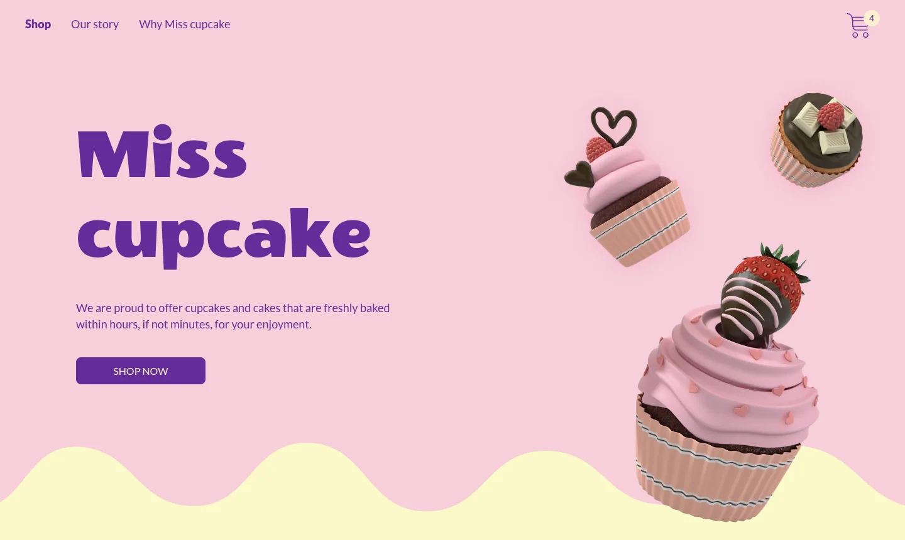
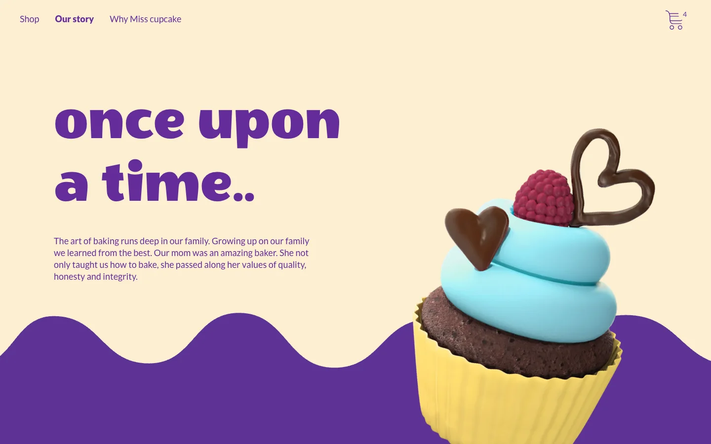
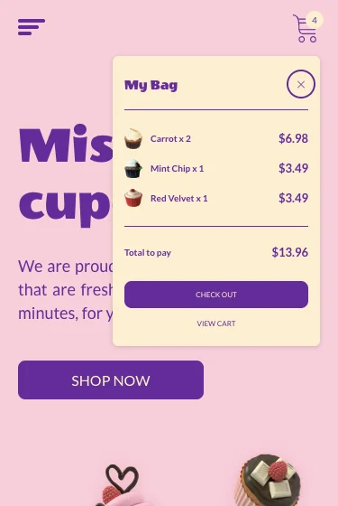
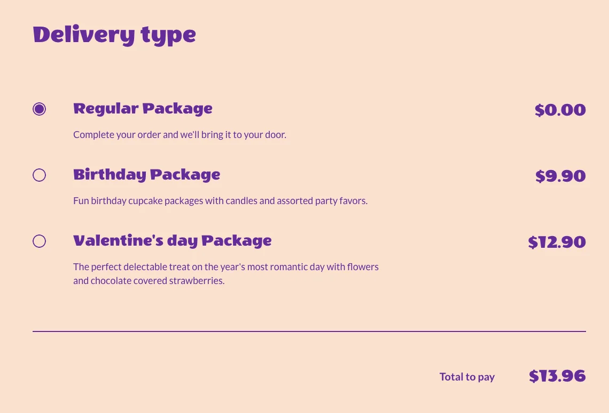

# Miss Cupcake

A cupcake shop website built from a Figma design: browse the cupcakes, fill a bag, and go through a full checkout.

## Links

- **Live site:** https://kotkoa.github.io/miss-cupcake/
- **Design (Figma):** [Miss Cupcake Prototype (Copy)](https://www.figma.com/design/cdK7lnOsfixA9OqNe17CrJ/Miss-Cupcake-Prototype--Copy-?node-id=0-1)
- **Code:** https://github.com/Kotkoa/miss-cupcake

## What you can do here

- Browse eleven cupcakes and pick how many you want of each.
- Add them to your bag. The bag remembers which cupcakes and how many, even if you close the page.
- Check out: change the amounts, pick a delivery type, fill in your details and place the order. This is a demo. There is no real payment and nothing you type is sent anywhere. Your name and address stay in your browser tab while you check out (card details are never kept) and disappear when you close it.
- Read the story of the bakery, watch a short video and find the store on a map. The page shows a picture of the map first; the interactive Google map loads only when you press the button.
- Sign up for the newsletter in the footer. Again, nothing is sent: the site only remembers that you signed up.
- Use it on a phone, a tablet or a computer. It also works with a keyboard alone, and it is built with screen readers in mind (checked with automated audits, not yet with a screen reader by ear).

## Screenshots

| The home page | Our story |
|---|---|
|  |  |

| My Bag on a phone | Choosing a delivery type |
|---|---|
|  |  |

## How it was built

Each choice below was made on purpose; the step-by-step plan and the decisions are written down in [`tasks/`](tasks/), start with [`tasks/05.0-architecture.md`](tasks/05.0-architecture.md).

- **React + Vite + TypeScript**: a fast setup, and the types catch mistakes before the browser does.
- **React Router**: separate pages with real addresses, so every page can be opened and shared directly.
- **CSS Modules with design tokens**: every colour, font size and spacing comes from the Figma file and lives in one place (`src/styles/tokens.css`), so the page matches the design and stays easy to change.
- **Jotai**: a small state library for the bag. The bag saves only the cupcake and its quantity, never prices or names.
- **Plain TypeScript form checks**: the checkout form is validated with small, tested functions instead of a form library, to keep the logic visible.
- **Vitest**: unit tests for the bag, the form rules and the other logic.
- **Accessibility and speed**: checked with axe and Lighthouse; the reports are in [`tasks/06.4-accessibility.md`](tasks/06.4-accessibility.md) and [`tasks/06.5-lighthouse.md`](tasks/06.5-lighthouse.md).
- **GitHub Pages + GitHub Actions**: every push to `main` runs the linter and the tests, builds the site and publishes it. If a test fails, nothing is published.

## Run it locally

You need Node 22 and Yarn 1.

```bash
git clone https://github.com/Kotkoa/miss-cupcake.git
cd miss-cupcake
yarn
yarn dev      # http://localhost:5173
yarn test     # unit tests
yarn build    # production build
```

`yarn build:pages` makes the build that is published: it serves the site from `/miss-cupcake/` and adds a folder per page, because GitHub Pages cannot rewrite addresses. To look at that build, run `yarn preview --base=/miss-cupcake/` and open http://localhost:4173/miss-cupcake/.

## Credits

- **Design and pictures:** the design and the cupcake pictures come from a Figma file that is a copy of an existing prototype ("Miss Cupcake Prototype"). The copy does not say who made it, and I could not find the source, so I cannot credit the designer by name. They are the original author's work, not mine, and no licence in this repository covers them. If you made them and want a credit or a removal, please open an issue.
- **Video:** "Cupcake, Cake, Food" by AmatusSamiTahera on [Pixabay](https://pixabay.com/videos/cupcake-cake-food-dessert-102743/) (Pixabay Content License).
- **Map:** © [OpenStreetMap contributors](https://www.openstreetmap.org/copyright), data under the ODbL. Details in [`CREDITS.md`](CREDITS.md).
- **Fonts:** [Wendy One](https://fonts.google.com/specimen/Wendy+One) and [Lato](https://fonts.google.com/specimen/Lato), served by [Fontsource](https://fontsource.org/).
